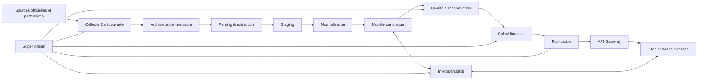
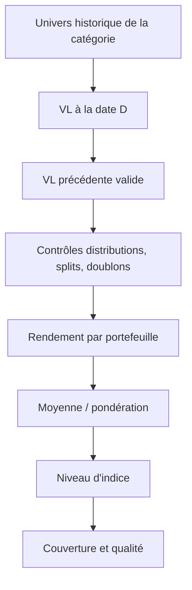
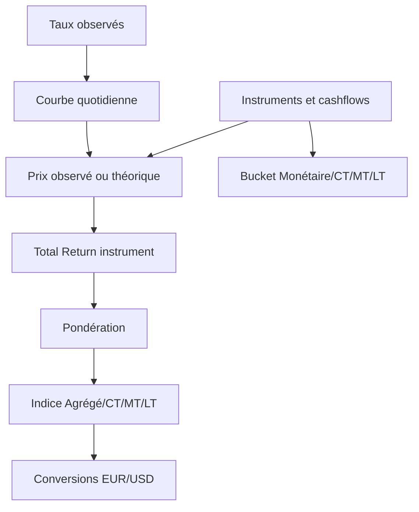
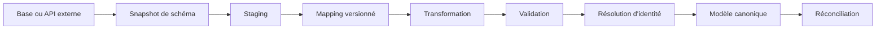

# 12 — Architecture de conception détaillée

**Projet :** AfricaFunds Market Data / SadiaAF  
**Principe directeur :** modular monolith bien découpé, puis extraction progressive des services nécessitant une isolation ou une montée en charge.

---

## 1. Architecture logique cible



---

## 2. Domaines fonctionnels

| Domaine | Responsabilité |
|---|---|
| Identity | utilisateurs, rôles, organisations, MFA, sessions |
| Administration | cockpit, validation, actions contrôlées |
| Source Registry | institutions, endpoints, formats, licences |
| Collection | téléchargement, pagination, discovery, retry |
| Raw Archive | stockage immuable et checksums |
| Parsing | HTML, CSV, Excel, JSON, XML/SDMX, PDF |
| Staging | observations externes avant validation |
| Normalization | types, dates, unités, devises, identités |
| Canonical Data | modèle stable AfricaFunds |
| Integration | schémas externes, mappings et synchronisations |
| Quality | anomalies, règles, scores, quarantaine |
| Calculation | courbes, prix, rendements, indices |
| Publication | vues, API, exports, webhooks |
| Scheduler | jobs, files, locks, backfills |
| Audit | journal immuable |
| Observability | logs, métriques, traces et PostHog |

---

## 3. Topologie de déploiement

### 3.1 Première cible

```text
reverse-proxy / Plesk
├── admin-web
├── api
├── worker-collector
├── worker-parser
├── worker-calc
├── scheduler
├── postgres
├── redis
├── object-storage
└── observability
```

### 3.2 Stratégie d’évolution

1. commencer avec un codebase commun et des processus séparés ;
2. utiliser des files et contrats internes stables ;
3. mesurer les goulots d’étranglement ;
4. extraire un service uniquement lorsqu’une raison opérationnelle est démontrée ;
5. conserver un modèle canonique et des événements compatibles.

---

## 4. Schémas PostgreSQL

```text
ref          référentiels géographiques, devises et catégories
source       sources, documents, fichiers, feuilles et cellules
staging      données externes non validées
market       indices, taux, change, inflation et instruments
fund         fonds, portefeuilles, classes, VL et événements
method       méthodologies et versions
calc         courbes, valorisations, compositions et indices
integration  systèmes externes, schémas, mappings et syncs
quality      règles, anomalies, contrôles et scores
publish      vues et séries publiées
identity     utilisateurs, rôles, organisations et clés
ops          jobs, runs, files, locks et supervision
audit        actions et changements immuables
```

---

## 5. Modèle de données principal

### 5.1 Référentiels

```text
ref.geographic_entities
ref.markets
ref.currencies
ref.asset_classes
ref.category_nodes
ref.category_currency_contexts
ref.calendars
ref.institutions
```

### 5.2 Sources et provenance

```text
source.source_endpoints
source.documents
source.raw_files
source.workbook_sheets
source.source_cells
source.extraction_runs
source.observation_provenance
```

### 5.3 Marché

```text
market.official_indices
market.official_index_observations
market.official_rate_series
market.official_rate_observations
market.instruments
market.instrument_cashflows
market.instrument_market_observations
market.fx_series
market.fx_observations
market.inflation_series
market.inflation_observations
```

### 5.4 Fonds

```text
fund.management_companies
fund.fund_portfolios
fund.funds
fund.share_classes
fund.fund_category_memberships
fund.nav_observations
fund.aum_observations
fund.distributions
fund.events
```

### 5.5 Méthodologies et calculs

```text
method.methodologies
method.methodology_versions
method.maturity_bucket_rules
method.calendar_rules

calc.yield_curves
calc.yield_curve_daily_versions
calc.yield_curve_points
calc.instrument_daily_valuations
calc.instrument_bucket_memberships
calc.index_definitions
calc.index_components
calc.index_constituents_daily
calc.index_daily_values
calc.category_daily_calculations
calc.category_daily_fund_contributions
```

### 5.6 Interopérabilité

```text
integration.external_systems
integration.external_connections
integration.schema_snapshots
integration.external_tables
integration.external_fields
integration.canonical_objects
integration.canonical_fields
integration.field_mappings
integration.value_mappings
integration.transformation_rules
integration.identifier_crosswalks
integration.data_contracts
integration.sync_definitions
integration.sync_runs
integration.sync_errors
integration.conflicts
integration.dead_letter_records
```

### 5.7 Sécurité et audit

```text
identity.users
identity.organizations
identity.roles
identity.permissions
identity.user_roles
identity.api_clients
identity.api_keys
identity.sessions
identity.mfa_factors

audit.events
```

---

## 6. Architecture de collecte

### 6.1 Interface d’un adaptateur

Chaque adaptateur doit exposer :

```text
discover()
listHistoricalWindows()
fetch(window)
parse(rawArtifact)
normalize(extractedRecords)
validate(normalizedRecords)
persist(validRecords)
reportCoverage()
```

### 6.2 Contrat de sortie

Chaque observation normalisée contient au minimum :

- identifiant de série ou d’objet ;
- marché ;
- date économique ;
- date de publication ;
- valeur ;
- unité ;
- devise ;
- statut qualité ;
- source et fichier ;
- version d’extraction ;
- empreinte du document ;
- identifiant du run.

### 6.3 Stratégie PDF

- extraction native lorsque le PDF contient du texte ;
- détection des tableaux ;
- lecture visuelle des pages lorsque nécessaire ;
- OCR uniquement en dernier recours ;
- conservation de la page et de la zone source ;
- tests de non-régression par document témoin.

---

## 7. Architecture des calculs

### 7.1 Calcul des catégories de fonds



### 7.2 Calcul obligataire



### 7.3 Invariants

- aucune anticipation ;
- maturité résiduelle à la date D ;
- méthodologie effective à D ;
- composition effective à D ;
- distinction prix observé/modèle/proxy ;
- conservation des cashflows et poids ;
- recalcul reproductible.

---

## 8. Architecture de l’interopérabilité



### 8.1 Drift de schéma

Chaque snapshot doit produire une empreinte. Une modification de table, type, contrainte ou cardinalité déclenche :

- un événement `schema_change_detected` ;
- une suspension éventuelle de la synchronisation ;
- une comparaison avant/après ;
- une revue des mappings ;
- un dry-run avant réactivation.

### 8.2 Stratégies de conflits

- source prioritaire ;
- valeur la plus récente ;
- validation humaine ;
- conservation parallèle ;
- rejet en dead-letter ;
- fusion conditionnelle.

La stratégie doit être définie par contrat de données.

---

## 9. Architecture API

### 9.1 API Gateway

Responsabilités :

- authentification ;
- scopes ;
- quotas ;
- rate limiting ;
- versionnement ;
- corrélation des requêtes ;
- audit ;
- routage ;
- documentation OpenAPI.

### 9.2 Ressources publiques/partenaires

```text
GET /api/v1/markets
GET /api/v1/indices
GET /api/v1/rates
GET /api/v1/yield-curves
GET /api/v1/instruments
GET /api/v1/funds
GET /api/v1/navs
GET /api/v1/categories
GET /api/v1/benchmarks
GET /api/v1/fx
GET /api/v1/inflation
```

### 9.3 Administration

```text
POST /api/v1/admin/sources
POST /api/v1/admin/jobs/{id}/retry
POST /api/v1/admin/mappings/{id}/approve
POST /api/v1/admin/publications/{id}/publish
POST /api/v1/admin/api-keys
GET  /api/v1/admin/audit
```

Toute action sensible doit être autorisée, confirmée et auditée.

---

## 10. Sécurité

- OIDC/OAuth2 ;
- MFA ;
- RBAC et ABAC/scopes ;
- secrets chiffrés ;
- rotation des clés ;
- comptes de service séparés ;
- lecture seule par défaut ;
- chiffrement en transit ;
- chiffrement des sauvegardes ;
- journal immuable ;
- protection CSRF/XSS/SQL injection ;
- limitation des uploads ;
- scan de dépendances ;
- scan de secrets ;
- politique de session et verrouillage.

---

## 11. Scheduler, files et concurrence

Types de jobs :

- ingestion quotidienne ;
- découverte hebdomadaire ;
- audit mensuel des sources ;
- backfill historique ;
- parsing différé ;
- normalisation ;
- recalcul ;
- publication ;
- synchronisation ;
- contrôle qualité ;
- sauvegarde.

Chaque job possède :

- identifiant ;
- type ;
- paramètres ;
- priorité ;
- tentative ;
- état ;
- timestamps ;
- verrou ;
- métriques ;
- erreur ;
- stratégie de reprise.

---

## 12. Observabilité

### Technique

- logs JSON corrélés ;
- métriques Prometheus ou équivalent ;
- traces OpenTelemetry ;
- dashboards ;
- alertes ;
- suivi des files ;
- erreurs de base ;
- latences API ;
- disponibilité des sources.

### Produit

PostHog :

- événements du cockpit ;
- adoption des fonctions ;
- erreurs utilisateur ;
- feature flags ;
- groupes par organisation, application, marché et adaptateur.

Aucune donnée financière sensible ou secret ne doit être envoyé à PostHog.

---

## 13. Environnements

### Local

- Docker Compose reproductible ;
- données synthétiques ;
- tests rapides ;
- aucun secret partagé.

### Staging

- domaines et secrets distincts ;
- données réelles limitées ;
- backfill pilote ;
- tests de synchronisation ;
- recette fonctionnelle et financière ;
- restauration et rollback.

### Production S1

- uniquement après tous les gates ;
- inventaire et sauvegarde de l’existant ;
- fenêtre de changement ;
- déploiement versionné ;
- health checks ;
- supervision ;
- rollback prêt.

---

## 14. Sauvegarde et reprise

- sauvegarde PostgreSQL complète ;
- sauvegarde des volumes ;
- sauvegarde du stockage brut ;
- manifeste avec checksums ;
- rétention définie ;
- restauration automatisée ;
- test périodique ;
- RPO/RTO documentés ;
- sauvegarde avant et après déploiement.

---

## 15. Principes de conception obligatoires

1. immutabilité du brut ;
2. versionnement des méthodes ;
3. dates d’effet explicites ;
4. absence de look-ahead ;
5. idempotence ;
6. traçabilité intégrale ;
7. distinction officiel/propriétaire ;
8. séparation lecture/écriture externe ;
9. dry-run avant synchronisation ;
10. documentation mise à jour dans chaque PR.
