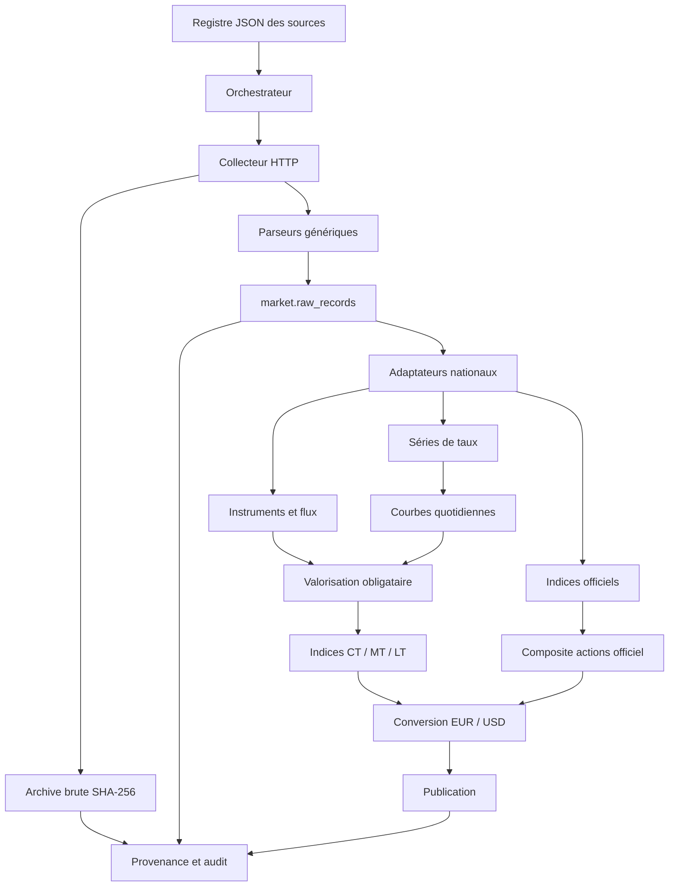

# Architecture technique

## Composants



## Séparation des données

| Couche | Contenu |
|---|---|
| Source | Endpoints et institutions |
| Raw | Réponses et fichiers originaux |
| Parsed | Lignes extraites sans interprétation métier |
| Normalized | Séries, dates, taux, instruments et devises harmonisés |
| Calculated | Courbes, prix de modèle, rendements et indices |
| Published | Dernières valeurs et historiques exposés à AfricaFunds |

## Idempotence

Un fichier est identifié par `(endpoint_code, sha256)`. Une seconde collecte du même contenu ne recrée pas un fichier ; elle actualise `last_seen_at`.

## Reprise historique

Les demandes sont divisées en fenêtres. Chaque fenêtre possède un statut indépendant :

```text
PENDING → RUNNING → SUCCESS
                 ↘ RETRY → FAILED
                 ↘ BLOCKED_ADAPTER
```

## Cron

Le scheduler ne lance qu’un travail à la fois dans le conteneur. Le déploiement système utilise en plus `flock` pour empêcher deux exécutions concurrentes.
