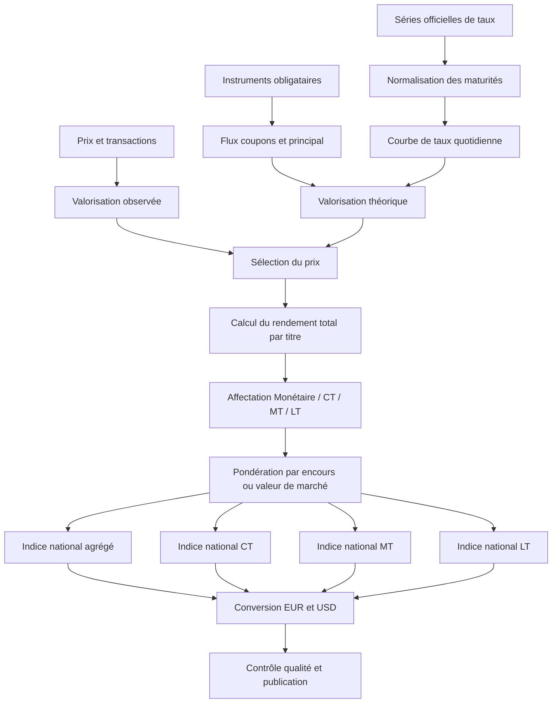
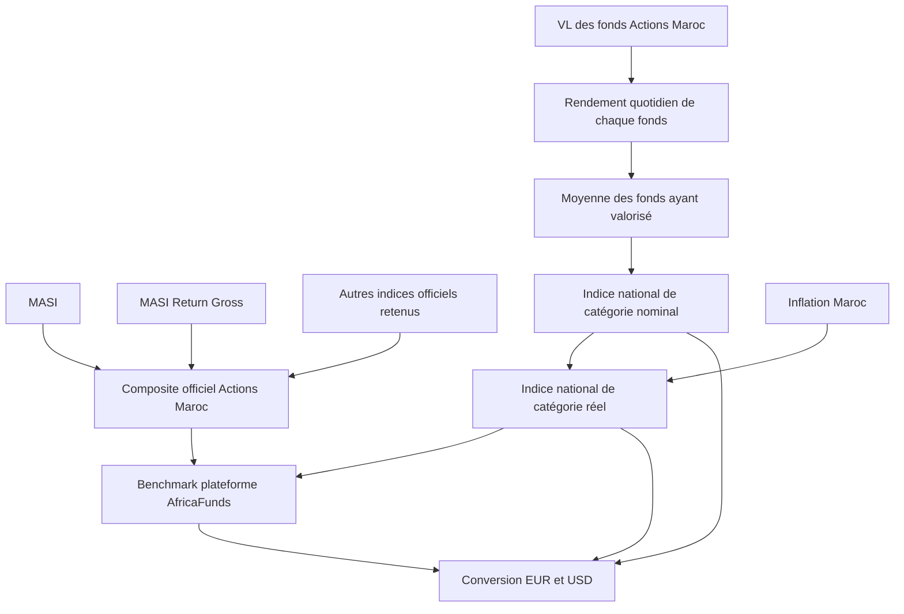

# AfricaFunds — Qualité, provenance, schémas et plan de mise en œuvre

> Partie de la spécification atomique de référence.


## 20.1 `quality.assessments`

```text
quality_assessment_id
object_type
object_id
observation_date
coverage_score
freshness_score
source_score
methodology_score
anomaly_score
overall_score
quality_status
calculation_run_id
```

## 20.2 `source.sources`

```text
source_id
organization_name
source_type
country_id
official_status
website_url
```

## 20.3 `source.documents`

```text
document_id
source_id
document_type
title
publication_date
url
checksum
local_archive_path
```

## 20.4 `source.raw_files`

```text
raw_file_id
document_id
file_name
mime_type
checksum
downloaded_at
archive_path
```

## 20.5 `source.workbook_sheets`

```text
workbook_sheet_id
raw_file_id
sheet_name
sheet_index
used_range
```

## 20.6 `source.source_cells`

```text
source_cell_id
workbook_sheet_id
cell_address
raw_value
normalized_value
row_number
column_number
```

## 20.7 `source.observation_provenance`

```text
observation_provenance_id
object_type
object_id
source_id
document_id
raw_file_id
workbook_sheet_id
source_cell_id
extraction_run_id
```

---

# 21. Schéma relationnel simplifié

```mermaid
erDiagram
    GEOGRAPHIC_ENTITY ||--o{ CATEGORY_NODE : contains
    ASSET_CLASS ||--o{ CATEGORY_NODE : classifies
    CATEGORY_NODE ||--o{ CATEGORY_NODE : parent_of
    CATEGORY_NODE ||--o{ CATEGORY_CURRENCY_CONTEXT : has

    FUND_PORTFOLIO ||--o{ FUND : contains
    FUND ||--o{ SHARE_CLASS : has
    FUND ||--o{ FUND_CATEGORY_MEMBERSHIP : assigned_to
    CATEGORY_NODE ||--o{ FUND_CATEGORY_MEMBERSHIP : groups
    SHARE_CLASS ||--o{ NAV_OBSERVATION : publishes

    CATEGORY_NODE ||--o{ CATEGORY_OFFICIAL_INDEX_LINK : references
    OFFICIAL_INDEX ||--o{ CATEGORY_OFFICIAL_INDEX_LINK : linked_to
    OFFICIAL_INDEX ||--o{ OFFICIAL_INDEX_OBSERVATION : has

    OFFICIAL_RATE_SERIES ||--o{ OFFICIAL_RATE_OBSERVATION : has
    INSTRUMENT ||--o{ INSTRUMENT_CASHFLOW : generates
    INSTRUMENT ||--o{ INSTRUMENT_MARKET_OBSERVATION : observed_as

    YIELD_CURVE ||--o{ YIELD_CURVE_DAILY_VERSION : versions
    YIELD_CURVE_DAILY_VERSION ||--o{ YIELD_CURVE_POINT : contains

    METHODOLOGY ||--o{ METHODOLOGY_VERSION : versions
    METHODOLOGY_VERSION ||--o{ INDEX_DEFINITION : governs
    INDEX_DEFINITION ||--o{ INDEX_COMPONENT : composed_of
    INDEX_DEFINITION ||--o{ INDEX_DAILY_VALUE : produces
    INDEX_DEFINITION ||--o{ INDEX_CONSTITUENT_DAILY : contains

    CATEGORY_NODE ||--o{ CATEGORY_DAILY_CALCULATION : calculated_for
    CATEGORY_DAILY_CALCULATION ||--o{ CATEGORY_DAILY_FUND_CONTRIBUTION : contains

    FX_SERIES ||--o{ FX_OBSERVATION : has
    INFLATION_SERIES ||--o{ INFLATION_OBSERVATION : has
    CALCULATION_RUN ||--o{ INDEX_DAILY_VALUE : creates
    CALCULATION_RUN ||--o{ QUALITY_ASSESSMENT : evaluates
```



---

# 22. Schéma de calcul obligataire



---

# 23. Schéma de calcul Actions Maroc



---

# 24. Pipeline de traitement

```text
1. Collecter les sources officielles
2. Archiver les documents et fichiers bruts
3. Extraire les observations atomiques
4. Normaliser les dates, devises, maturités et identifiants
5. Contrôler les doublons et anomalies
6. Construire les courbes quotidiennes
7. Valoriser les instruments
8. Affecter les instruments aux segments CT/MT/LT
9. Calculer les indices locaux
10. Calculer les indices de catégorie des fonds
11. Ajuster les catégories à l’inflation
12. Calculer les benchmarks plateforme
13. Convertir toutes les séries en EUR et USD
14. Calculer les scores de qualité
15. Publier les séries et métadonnées
```

---

# 25. Première base minimale à créer

## Lot A — Référentiel

```text
ref.geographic_entities
ref.currencies
ref.asset_classes
ref.category_nodes
ref.category_currency_contexts
```

## Lot B — Fonds

```text
fund.management_companies
fund.fund_portfolios
fund.funds
fund.share_classes
fund.fund_category_memberships
fund.nav_observations
```

## Lot C — Marché

```text
market.official_indices
market.official_index_observations
market.category_official_index_links
market.official_rate_series
market.official_rate_observations
market.instruments
market.instrument_cashflows
market.instrument_market_observations
market.fx_series
market.fx_observations
market.inflation_series
market.inflation_observations
```

## Lot D — Méthodologie et calcul

```text
method.methodologies
method.methodology_versions
method.maturity_bucket_rules
calc.yield_curves
calc.yield_curve_daily_versions
calc.yield_curve_points
calc.index_definitions
calc.index_components
calc.category_daily_calculations
calc.category_daily_fund_contributions
calc.instrument_daily_valuations
calc.instrument_bucket_memberships
calc.index_constituents_daily
calc.index_daily_values
calc.calculation_runs
```

## Lot E — Qualité et provenance

```text
quality.assessments
source.sources
source.documents
source.raw_files
source.workbook_sheets
source.source_cells
source.observation_provenance
```

---

# 26. Contraintes fondamentales

1. Une observation économique ne doit jamais être écrasée.
2. Toute correction crée une nouvelle version ou un statut de remplacement.
3. Toutes les relations de catégorie sont historisées.
4. Toutes les méthodologies ont une date d’effet.
5. Toute valeur d’indice peut être reconstruite.
6. Toute donnée peut remonter jusqu’à sa source.
7. Les séries locale, EUR et USD sont stockées séparément.
8. Les indices officiels importés ne sont jamais confondus avec les indices AfricaFunds.
9. Les prix observés et les prix de modèle sont conservés séparément.
10. Les segments CT, MT et LT utilisent la maturité résiduelle à la date du calcul.
11. Le nombre de fonds et d’instruments utilisés est conservé pour chaque date.
12. Aucun indice n’est publié sans score de couverture et statut de qualité.

---

# 27. Identifiants proposés

```text
Catégorie Actions Maroc                  CAT-EQ-MAR
Catégorie Obligations Maroc              CAT-BOND-MAR
Catégorie Obligations CT Maroc           CAT-BOND-MAR-CT
Catégorie Obligations MT Maroc           CAT-BOND-MAR-MT
Catégorie Obligations LT Maroc           CAT-BOND-MAR-LT

Indice catégorie Actions Maroc           AF-CAT-EQ-MAR-NOM
Indice réel Actions Maroc                AF-CAT-EQ-MAR-REAL
Composite officiel Actions Maroc         AF-OFFICIAL-EQ-MAR
Benchmark plateforme Actions Maroc       AF-BMK-EQ-MAR

Indice obligataire agrégé Maroc          AF-BOND-MAR-AGG
Indice obligataire CT Maroc              AF-BOND-MAR-CT
Indice obligataire MT Maroc              AF-BOND-MAR-MT
Indice obligataire LT Maroc              AF-BOND-MAR-LT

Courbe souveraine Maroc                  AF-YC-GOV-MAR
Indice monétaire Maroc                   AF-MM-MAR
```

---

# 28. Résultat attendu

Cette architecture permet de répondre, pour n’importe quelle date :

```text
Quels fonds appartenaient à la catégorie ?
Quels fonds ont valorisé ?
Quels instruments existaient ?
Quelle était leur maturité résiduelle ?
Quel segment CT, MT ou LT leur était affecté ?
Quels taux étaient disponibles ?
Quelle courbe a été construite ?
Quelle méthode de valorisation a été utilisée ?
Quels poids ont été appliqués ?
Quel rendement a été obtenu ?
Quel niveau d’indice a été publié ?
Quel taux de change a été utilisé ?
Quel était le score de qualité ?
Quelle est la provenance exacte de chaque donnée ?
```

