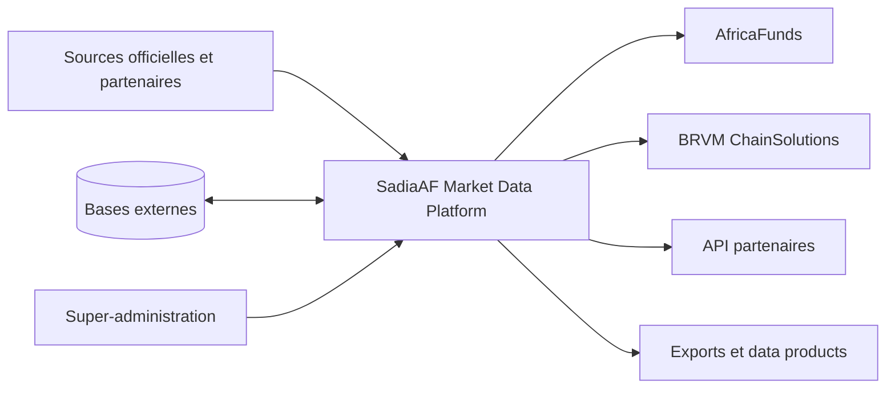
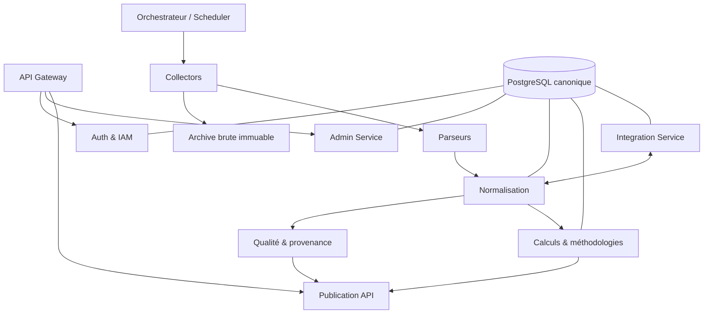
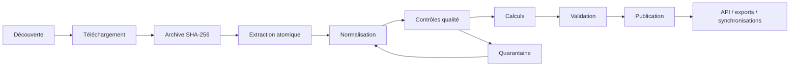
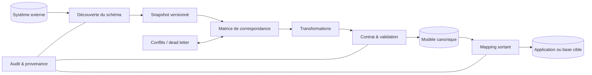
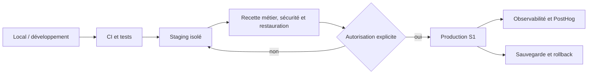

# SadiaAF / AfricaFunds Market Data — Mémoire vivante

**Version :** 1.0  
**Date :** 31 juillet 2026  
**Statut :** cadrage consolidé avant développement complet et avant toute production  
**Dépôt :** `Patricked-code/africafunds-market-data-pipeline`  
**Commit de base audité :** `fb7ec155fc748b133a771564bbd4510e1546fc68`

> Ce document est le point d’entrée stable de la mémoire du projet. Il consolide les décisions prises dans la conversation, les éléments réellement présents dans le dépôt et l’architecture cible. Il doit être mis à jour avec le code à chaque décision structurante, évolution de schéma, méthodologie, intégration ou changement d’état.

## 1. Décision de production

La mise en production sur S1 est **volontairement différée**.

Aucun déploiement ne doit être lancé avant :

1. validation du cahier et des décisions ouvertes ;
2. implémentation de la sécurité et du cockpit `SUPER_ADMIN` ;
3. validation des migrations sur PostgreSQL réel ;
4. finalisation des adaptateurs prioritaires et des calculs ;
5. tests automatisés, staging et recette métier ;
6. sauvegarde, restauration et rollback testés ;
7. autorisation explicite de production.

Domaines futurs :

- `sadiaaf.wealthtechinnovations.com` : cockpit et supervision ;
- `api.sadiaaf.wealthtechinnovations.com` : API sécurisée et versionnée.

## 2. Vision du produit

SadiaAF n’est ni un simple site web ni un scraper ponctuel. Il doit devenir une **plateforme autonome, multi-applications, interopérable et auditable de données financières africaines**.

La plateforme doit :

- collecter les données des bourses, banques centrales, régulateurs, agences de dette, instituts statistiques, sociétés de gestion et partenaires autorisés ;
- conserver les pages, fichiers et documents d’origine sans écrasement ;
- extraire des observations atomiques et traçables ;
- normaliser les dates, devises, unités, maturités, instruments et identifiants ;
- construire des courbes, valorisations, indices et benchmarks ;
- évaluer la couverture, la fraîcheur et la qualité ;
- publier les résultats via API, exports et synchronisations ;
- recevoir ou envoyer des données à d’autres bases sous contrat et avec audit.

AfricaFunds est un consommateur métier majeur, mais pas l’unique consommateur. D’autres sites WealthTech, applications mobiles, partenaires, data warehouses et outils d’analyse pourront utiliser la plateforme.



## 3. Principes non négociables

1. Aucune source brute n’est écrasée.
2. Chaque artefact est identifié par SHA-256.
3. Les traitements sont idempotents et reprenables.
4. Les couches Source, Raw, Parsed, Normalized, Calculated et Published restent séparées.
5. Toute valeur peut remonter à son organisation, endpoint, document, fichier, feuille, ligne et cellule lorsque disponibles.
6. Une correction crée une nouvelle version ou un statut de remplacement.
7. Les indices officiels importés ne sont jamais confondus avec les indices AfricaFunds.
8. Les méthodologies, mappings, classifications et règles ont des périodes de validité.
9. Les prix observés et les prix de modèle sont conservés séparément.
10. Aucun indice n’est publié sans couverture, qualité, provenance et version de méthodologie.
11. Les données numériques utilisent des types décimaux, conventions et unités explicites.
12. Les changements structurants passent par branche, tests et pull request.
13. Aucune action destructive sur S1 sans sauvegarde et validation explicite.

## 4. État réel du socle v0.2

### Existant

- dépôt TypeScript/Node.js autonome ;
- PostgreSQL 16 et migrations SQL ;
- Docker Compose ;
- collecteur HTTP avec reprises ;
- archive locale immuable SHA-256 ;
- extraction HTML, CSV, XLS et XLSX ;
- découverte de PDF, JSON, ZIP et documents liés ;
- stockage brut JSONB ;
- registre de 11 marchés et plus de 44 endpoints ;
- suivi des exécutions et santé des sources ;
- backfills historiques par fenêtres reprenables ;
- fonctions de calcul initiales ;
- API HTTP de consultation en lecture seule ;
- tableau de supervision statique ;
- scheduler interne ;
- scripts de précontrôle, sauvegarde, déploiement et rollback S1.

### Existant mais à valider

- installation npm complète dans un environnement standard ;
- exécution des migrations sur PostgreSQL réel ;
- démarrage complet de tous les conteneurs ;
- comportement des scripts sur un staging proche de S1 ;
- performances, restauration et sécurité.

### À développer ou finaliser

- authentification, MFA, RBAC et organisations ;
- véritable cockpit `SUPER_ADMIN` ;
- clés API, OAuth2/OIDC, scopes et quotas ;
- dictionnaire canonique exécutable ;
- interopérabilité multi-bases et matrices de correspondance ;
- adaptateurs spécifiques encore bloqués ;
- bootstrap complet des courbes ;
- moteur complet de Total Return obligataire ;
- indices de catégories de fonds ;
- benchmarks définitifs ;
- instrumentation PostHog et observabilité technique ;
- CI complète, staging et recette.

## 5. Architecture cible

L’architecture logique comprend les responsabilités suivantes :

- **API Gateway** : routage, versionnement, contrôle d’accès, quotas et observabilité ;
- **Auth/IAM** : utilisateurs, organisations, rôles, MFA, sessions et clés API ;
- **Admin Service** : cockpit, validations, relances, publications et audit ;
- **Source Registry** : institutions, endpoints, licences, fréquences et adaptateurs ;
- **Collector Service** : collecte incrémentale, découverte et backfills ;
- **Parser Service** : extraction HTML, CSV, Excel, PDF, JSON et formats spécialisés ;
- **Normalization Service** : modèle canonique, identités, unités, dates et devises ;
- **Mapping/Integration Service** : découverte de schémas, mappings et synchronisations ;
- **Quality Service** : anomalies, couverture, fraîcheur, quarantaine et approbation ;
- **Calculation Service** : courbes, valorisations, indices, FX, inflation et benchmarks ;
- **Publication Service** : séries publiées, API, exports, webhooks et data products ;
- **Scheduler/Workers** : orchestration, files, reprises et traitements planifiés ;
- **Notification Service** : alertes métier et opérationnelles.

La première implémentation peut rester un **modular monolith** TypeScript avec workers séparés. Les services seront extraits seulement lorsque les besoins de charge, isolation, sécurité ou équipes le justifieront.



## 6. Flux de données



États de backfill :

```text
PENDING → RUNNING → SUCCESS
                 ↘ RETRY → FAILED
                 ↘ BLOCKED_ADAPTER
```

Une source dynamique non comprise doit rester `BLOCKED_ADAPTER`. Elle ne doit jamais être annoncée comme terminée.

## 7. Architecture des données

Schémas PostgreSQL cibles :

| Schéma | Responsabilité |
|---|---|
| `ref` | géographie, devises, calendriers, classes d’actifs et taxonomie |
| `fund` | sociétés de gestion, portefeuilles, fonds, classes, VL, AUM, distributions et événements |
| `market` | indices officiels, taux, instruments, cashflows, FX et inflation |
| `method` | méthodologies, versions, maturités, pondérations et règles |
| `calc` | courbes, valorisations, constituants, indices et runs de calcul |
| `quality` | contrôles, anomalies, scores, validations et quarantaine |
| `source` | organisations, endpoints, documents, fichiers, feuilles, cellules et provenance |
| `integration` | systèmes externes, snapshots de schéma, mappings, contrats, syncs et conflits |
| `identity` | utilisateurs, organisations, rôles, permissions, clés API et audit sécurité |
| `publish` | séries et objets exposés par API ou export |
| `ops` | exécutions, files, backfills, locks, alertes et supervision |

Chaque observation économique est historisée. Les identifiants techniques sont stables et les identifiants externes sont conservés dans des crosswalks.

## 8. Taxonomie AfricaFunds N1 à N6

```text
N1 — Grande classe d’actifs
└── N2 — Classe d’actifs Afrique EUR / USD
    └── N3 — Région Afrique EUR / USD
        └── N4 — Marché national en devise locale
            └── N5 — Catégorie nationale spécialisée
                └── N6 — Segment spécialisé
```

Classes initiales : Actions, Obligations, Monétaire, Diversifiés, Immobilier, Matières premières, Alternatifs et Cash/Trésorerie.

Segments obligataires initiaux selon la maturité résiduelle :

- Monétaire : 0 à 1 an inclus ;
- CT : plus de 1 an à 3 ans inclus ;
- MT : plus de 3 ans à 7 ans inclus ;
- LT : plus de 7 ans.

Un instrument change de segment au fil du temps. L’appartenance quotidienne doit être conservée.

## 9. Marchés initiaux

| Code | Marché | Devise | Référence actions large | Référence monétaire prioritaire |
|---|---|---|---|---|
| MAR | Maroc | MAD | MASI | MONIA |
| GHA | Ghana | GHS | GSE Composite | interbancaire / BoG Bills |
| UEMOA | BRVM/UEMOA | XOF | BRVM Composite | interbancaire BCEAO |
| TUN | Tunisie | TND | TUNINDEX | TMM |
| EGY | Égypte | EGP | EGX100 EWI | CONIA |
| NGA | Nigeria | NGN | NGX All-Share | NOFRI |
| KEN | Kenya | KES | NSE All Share | KESONIA |
| CEMAC | BVMAC/CEMAC | XAF | BVMAC All Share | interbancaire BEAC |
| BWA | Botswana | BWP | Domestic Company Index | BoBC |
| NAM | Namibie | NAD | NSX Overall | T-Bills / benchmark yields |
| ETH | Éthiopie | ETB | à définir | T-Bills 28/91/182/364 jours |

Les désignations officielles, variantes Price/Gross/Net Total Return et droits de redistribution doivent être confirmés et versionnés.

## 10. Fonds, classes et événements

Le modèle doit distinguer :

```text
ManagementCompany
FundPortfolio
Fund
ShareClass
FundCategoryMembership
FundNAVObservation
FundAUMObservation
FundDistribution
FundEvent
```

Il doit gérer les alias, changements de nom, changements de gestionnaire, fusions, absorptions, splits, liquidations, classes de parts, devises et appartenances historiques aux catégories.

L’indice de catégorie doit éviter le double comptage d’un même portefeuille via plusieurs classes. Les règles de classe représentative, VL manquante, distributions et exclusions doivent être écrites dans une méthodologie versionnée.

## 11. Obligations, courbes et Total Return

Le moteur cible doit :

1. normaliser les séries de taux et maturités ;
2. construire des courbes quotidiennes avec points observés et interpolés ;
3. modéliser instruments et cashflows ;
4. calculer intérêt couru, prix propre et prix sale ;
5. choisir un prix observé, interpolé, modèle ou proxy ;
6. calculer duration, convexité, DV01 et rendement total ;
7. affecter chaque titre à Monétaire/CT/MT/LT ;
8. pondérer par encours ou valeur de marché ;
9. produire des indices agrégé, CT, MT et LT ;
10. convertir les rendements en EUR et USD.

Méthodes de valorisation :

```text
OBSERVED_PRICE
INTERPOLATED_PRICE
MODEL_PRICED
CONSTANT_MATURITY_PROXY
```

Formule de principe :

```text
Total Return(t) = [Prix sale(t) + flux reçus(t)] / Prix sale(t-1) - 1
```

## 12. Indices de catégories et benchmarks

Familles distinctes :

```text
OFFICIAL_REFERENCE_COMPOSITE
CATEGORY_NOMINAL
CATEGORY_REAL
MARKET_TOTAL_RETURN
MARKET_CONSTANT_MATURITY
PLATFORM_BENCHMARK
```

L’indice national de catégorie nominal est construit quotidiennement à partir des fonds éligibles ayant valorisé à la date, en conservant le nombre de fonds, la couverture, les exclusions et les contributions. L’indice réel ajuste le nominal par inflation.

Le benchmark plateforme est un indice synthétique propre à AfricaFunds, combinant des références officielles et un indice de catégorie réel selon des poids, dates d’effet et méthodologies versionnés. Il ne doit jamais être présenté comme officiel.

Les séries sont calculées en devise locale puis converties par les rendements :

```text
1 + rendement EUR(t)
= [1 + rendement local(t)] × [FX local/EUR(t) / FX local/EUR(t-1)]
```

## 13. Interopérabilité multi-bases

La plateforme doit reconnaître et versionner les schémas de : PostgreSQL, MySQL/MariaDB, SQL Server, Oracle, ClickHouse, MongoDB, Supabase, REST, GraphQL, CSV, Excel, JSON, XML, Parquet, SFTP et stockage objet.

Objets cibles du schéma `integration` :

```text
external_systems
external_connections
schema_snapshots
external_tables
external_fields
canonical_objects
canonical_fields
field_mappings
value_mappings
transformation_rules
identifier_crosswalks
data_contracts
sync_definitions
sync_runs
sync_errors
conflicts
dead_letter_records
```

Chaque mapping possède une version, période de validité, transformation, règle de validation, niveau de confiance, auteur et statut `PROPOSED`, `APPROVED`, `ACTIVE` ou `RETIRED`.



Toute écriture externe utilise contrat de données, dry-run, validation, idempotency key, stratégie d’upsert, gestion de conflit et journal d’audit.

## 14. API cible

Familles de routes :

```text
/auth/*
/api/v1/markets
/api/v1/indices
/api/v1/rates
/api/v1/yield-curves
/api/v1/instruments
/api/v1/funds
/api/v1/share-classes
/api/v1/navs
/api/v1/categories
/api/v1/benchmarks
/api/v1/fx
/api/v1/inflation
/api/v1/integrations/*
/api/v1/admin/*
/api/v1/quality/*
/api/v1/audit/*
```

Exigences : OpenAPI, pagination, filtres, dates de version, OAuth2/OIDC, clés API, scopes, quotas, rate limiting, webhooks signés et journal d’utilisation.

## 15. Super-administration et sécurité

Le premier déploiement final doit créer la base, exécuter les migrations et créer un premier compte `SUPER_ADMIN` à partir d’un secret temporaire hors Git. Le changement de mot de passe et le MFA sont obligatoires.

Rôles cibles :

- `SUPER_ADMIN` ;
- administrateur plateforme ;
- administrateur données ;
- contrôleur qualité ;
- opérateur collecte ;
- validateur méthodologique ;
- développeur API/intégration ;
- lecteur/auditeur.

Le cockpit doit gérer utilisateurs, organisations, clés API, sources, adaptateurs, backfills, mappings, anomalies, calculs, publications, sauvegardes et audit.

Sécurité : secrets hors Git, chiffrement TLS, moindre privilège, rotation, MFA, journal immuable, séparation staging/production et confirmation renforcée pour les opérations sensibles.

## 16. Qualité et publication

Scores : couverture, fraîcheur, source, méthodologie, anomalie et score global.

Statuts :

```text
RAW
PARSED
NORMALIZED
QUARANTINED
VALIDATED
CALCULATED
PUBLISHED
SUPERSEDED
REJECTED
```

Une publication doit inclure : données, métadonnées, provenance, couverture, qualité, méthodologie, version, date de calcul et date de publication.

## 17. PostHog et observabilité

PostHog est connecté, mais aucune instrumentation métier AfricaFunds n’est encore active. Il servira à l’analytics produit, aux parcours du cockpit, aux événements métier et aux feature flags.

Événements prévus :

```text
admin_login_succeeded
admin_login_failed
source_created
adapter_enabled
backfill_started
backfill_completed
backfill_failed
schema_discovered
schema_change_detected
field_mapping_proposed
field_mapping_approved
sync_started
sync_completed
sync_failed
yield_curve_published
index_calculation_completed
index_published
api_key_created
```

PostHog ne remplace pas l’observabilité technique. Logs structurés, métriques, traces distribuées, alertes, surveillance PostgreSQL et conteneurs sont requis.

## 18. Outils et services du projet

| Outil/service | Rôle |
|---|---|
| GitHub | code, branches, PR, historique et mémoire versionnée |
| S1 / Plesk | futur hébergement après recette |
| `wealthtech_ssh_bridge` | accès contrôlé aux serveurs, indisponible lors des derniers essais |
| Docker / Compose | reproductibilité locale, staging et production |
| PostgreSQL | base canonique, historique et audit |
| Node.js / TypeScript | API, collecteurs, workers et calculs |
| PostHog | analytics produit, feature flags et erreurs front/app |
| Supabase | option ou système externe ; pas source de vérité automatique sans décision |
| Data Analytics | analyse, contrôle et exploration des fichiers |
| Web research | découverte et validation des sources officielles |
| GitHub Actions / CI | build, tests, scans et artefacts à mettre en place |
| OpenTelemetry + métriques | observabilité technique cible |
| MinIO/S3 ou filesystem | stockage brut à arbitrer |

## 19. Mode de réalisation

Ordre recommandé :

1. **Cadrage final** : décisions, rôles, licences, RPO/RTO, conventions et ADR.
2. **Fondations** : CI, dépendances, migrations réelles, sauvegarde/restauration et staging.
3. **Sécurité** : IAM, MFA, RBAC, organisations, clés API et audit.
4. **Modèle canonique** : dictionnaire exécutable, identités, événements et provenance.
5. **Interopérabilité** : découverte de schémas, mappings et deux systèmes pilotes.
6. **Collecte** : adaptateurs prioritaires, fixtures, pagination, reprise et détection de formats.
7. **Calculs** : courbes, maturités, valorisations, Total Return et tests de référence.
8. **Indices** : catégories, benchmarks, FX, inflation, versions et publication.
9. **Cockpit** : supervision, validations, mappings, relances et publications.
10. **Observabilité** : PostHog, logs, métriques, traces et alertes.
11. **Recette** : tests de charge, sécurité, sauvegarde, restauration et métier.
12. **Production** : inventaire S1, sauvegarde, déploiement, recette externe et rollback.



## 20. Adaptateurs et moteurs restant à finaliser

- CBE Égypte : endpoints dynamiques CONIA, T-Bills et T-Bonds ;
- BCT Tunisie : requêtes GOSDMX/SDMX ;
- certaines sources NSE et CBK au Kenya ;
- pages dynamiques et historiques EGX ;
- PDF, tableaux, adjudications et instruments UMOA-Titres ;
- bulletins et séries BEAC ;
- normalisation automatique des maturités ;
- bootstrap et interpolation des courbes ;
- moteur complet de prix, cashflows et Total Return ;
- indices de catégories de fonds ;
- benchmarks définitifs de plateforme.

Chaque élément doit avoir fixtures, tests historiques, contrôle des dates et preuve de traçabilité.

## 21. Registre des décisions principales

| ID | Décision |
|---|---|
| D-001 | SadiaAF est le moteur central de données ; AfricaFunds est un consommateur métier. |
| D-002 | PostgreSQL est la base canonique initiale. |
| D-003 | Aucune source brute n’est écrasée et chaque artefact est identifié par SHA-256. |
| D-004 | Les couches de données et les indices officiels/propriétaires sont séparés. |
| D-005 | La taxonomie suit N1 à N6 et les séries existent en local, EUR et USD. |
| D-006 | Les segments obligataires utilisent la maturité résiduelle quotidienne. |
| D-007 | Le premier déploiement final crée DB, migrations et super-admin sécurisé. |
| D-008 | Une couche d’interopérabilité et des mappings versionnés sont obligatoires. |
| D-009 | Les écritures externes passent par contrats, dry-run, audit et gestion de conflits. |
| D-010 | PostHog suit l’usage produit et les feature flags, pas la vérité financière. |
| D-011 | Une observabilité technique complète PostHog. |
| D-012 | La production S1 est différée jusqu’à staging, recette et autorisation explicite. |
| D-013 | Les sources bloquées sont signalées, jamais déclarées terminées. |
| D-014 | La mémoire vivante est versionnée et mise à jour avec chaque décision. |

## 22. Risques principaux

- changements de formats des portails ;
- droits et licences de redistribution ;
- historiques incomplets ;
- confusion portefeuille/fonds/classes ;
- erreurs numériques ou de conventions ;
- écrasement de données partenaires ;
- fuite de secrets ;
- migrations irréversibles ;
- sur-architecture microservices ;
- backfills trop lourds ;
- calculs non reproductibles ;
- production prématurée.

Mesures : fixtures, schema fingerprints, types décimaux, contrats, dry-run, chiffrement, scans, migrations additives, staging, fenêtres de reprise, méthodologies versionnées et gate de production.

## 23. Questions encore ouvertes

- choix IAM/OIDC ;
- choix du stockage objet ;
- SLA, RPO et RTO ;
- licences de publication par série ;
- pondérations définitives des benchmarks ;
- politique de VL manquante et classes représentatives ;
- méthode de bootstrap/interpolation par marché ;
- premiers systèmes pilotes d’interopérabilité ;
- rôles exacts et circuit à quatre yeux ;
- domaines de staging ;
- politique de conservation ;
- stack de métriques/traces ;
- référence actions pour l’Éthiopie ;
- ordre des backfills complets.

## 24. Définition de terminé avant production

- cahier, ADR et dictionnaire validés ;
- migrations exécutées sur une base réelle et restaurable ;
- super-admin, MFA, RBAC, organisations et clés API opérationnels ;
- adaptateurs prioritaires testés sur fixtures et historiques ;
- provenance et qualité disponibles de bout en bout ;
- courbes, valorisations, Total Return, indices et FX testés indépendamment ;
- mappings et synchronisations pilotes audités dans les deux sens ;
- OpenAPI versionnée et testée ;
- PostHog et observabilité technique instrumentés ;
- staging validé en sécurité, performance, sauvegarde, restauration et métier ;
- inventaire S1, rollback et autorisation de production enregistrés.

## 25. Protocole de mise à jour

Chaque évolution de cette mémoire doit indiquer :

```text
Version : x.y
Date : YYYY-MM-DD
Auteur / relecteur :
Décisions ajoutées : D-xxx
Exigences modifiées :
Schémas/migrations associés :
PR / commit :
Impact API :
Impact données :
Impact sécurité :
État : local / CI / test / staging / production
```

Règles :

1. une décision structurante reçoit un identifiant ;
2. une évolution d’architecture actualise diagrammes et services ;
3. un champ canonique actualise dictionnaire et mappings ;
4. une méthodologie reçoit version, date d’effet et approbation ;
5. un changement de source actualise registre, fixtures et contrôles ;
6. chaque release actualise la matrice des statuts ;
7. les éléments remplacés restent dans l’historique Git.

## 26. Documents détaillés liés

- [`ARCHITECTURE.md`](ARCHITECTURE.md)
- [`DATA_DICTIONARY.md`](DATA_DICTIONARY.md)
- [`SOURCE_ADAPTERS.md`](SOURCE_ADAPTERS.md)
- [`OPERATIONS.md`](OPERATIONS.md)
- [`ARCHITECTURE_ATOMIQUE_REFERENCE.md`](ARCHITECTURE_ATOMIQUE_REFERENCE.md)
- [`S1_DEPLOYMENT.md`](S1_DEPLOYMENT.md)
- [`../PROJECT_STATUS.md`](../PROJECT_STATUS.md)

## Conclusion

Le dépôt actuel est une base sérieuse pour l’ingestion et l’audit. Le produit cible est plus ambitieux : une plateforme financière africaine multi-applications, interopérable, sécurisée et méthodologiquement reproductible. La priorité est de transformer ce cadrage en backlog exécutable, migrations, contrats, adaptateurs, tests et cockpit, puis de démontrer le fonctionnement en staging. La production S1 reste différée jusqu’à satisfaction de tous les critères précédents.